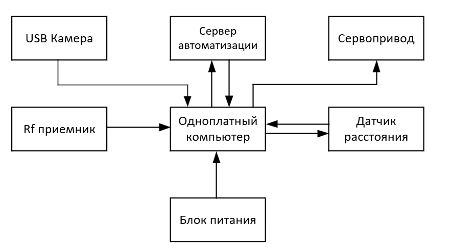

# Система распознавания автомобильных номеров со шлагбаумом

Автономная система контроля въезда на Raspberry Pi 4: камера читает номер автомобиля, сверяет его со списком разрешённых и открывает шлагбаум. Всё работает локально, без облака. Управление и события — через Home Assistant.



## Возможности

- Обнаружение номера в кадре (YOLO v9) и распознавание символов (OCR Global Plates Mobile ViT v2) через библиотеку [`fast-alpr`](https://github.com/ankandrew/fast-alpr)
- Нечёткая сверка с базой по расстоянию Левенштейна (до 2 символов), нормализация латиницы в кириллицу — защита от ошибок OCR
- Защита от ложных срабатываний: голосование по последним 5 кадрам, подтверждение при ≥ 2 совпадениях, пауза 10 с между повторными открытиями
- «Умное» закрытие: ультразвуковой датчик ждёт, пока автомобиль проедет, и закрывает шлагбаум через 5 с; если машина не появилась за 30 с, закрывает сам
- Ручное управление: кнопки «Открыть» / «Закрыть» в Home Assistant и радиопульт 433 МГц (открытие)
- Список разрешённых номеров редактируется из интерфейса Home Assistant, без перезапуска; файл перечитывается каждые 30 с
- Журнал событий в файле и в Home Assistant (MQTT)

## Как это работает

```
USB-камера → YOLO v9 (поиск номера) → OCR → голосование (5 кадров)
          → сверка со списком (Левенштейн ≤ 2) → ШИМ на GPIO → сервопривод
                                   ↓
                      MQTT (Mosquitto) ↔ Home Assistant
```

## Железо

| Компонент | Подключение | Назначение |
|---|---|---|
| Raspberry Pi 4 (8 ГБ) | — | вычисления, нейросети на CPU |
| USB-камера 1280×720 | USB | видеопоток, 1 кадр в 2 с идёт на распознавание |
| Сервопривод SG90 | GPIO 18, ШИМ 50 Гц | макет шлагбаума |
| Ультразвуковой датчик HC-SR04 | TRIG — GPIO 23, ECHO — GPIO 24 (через делитель напряжения 5 В → 3,3 В) | контроль проезда |
| Приёмник MX-RM-5V, 433 МГц | DATA — GPIO 27 | управление с пульта |
| Блок питания 5 В, комплект охлаждения | — | стабильная работа под нагрузкой |

Схема подключения: [`docs/wiring.png`](docs/wiring.png)

## Установка

1. Raspberry Pi OS, затем Docker:
   ```bash
   curl -fsSL https://get.docker.com | sh
   sudo usermod -aG docker $USER
   ```
2. Home Assistant и Eclipse Mosquitto в контейнерах:
   ```bash
   docker run -d --name homeassistant --restart=always --privileged \
     --network=host -v ~/homeassistant:/config \
     ghcr.io/home-assistant/home-assistant:stable
   ```
   Mosquitto — контейнер `eclipse-mosquitto` на порту 1883. В Home Assistant подключите интеграцию MQTT (адрес брокера `127.0.0.1`).
3. Зависимости:
   ```bash
   pip install -r requirements.txt
   ```
4. Скопируйте `grz.example.txt` в `grz.txt` и впишите разрешённые номера (или добавьте их позже из интерфейса Home Assistant).
5. Запуск:
   ```bash
   python3 main.py
   ```
   Остановка: `Ctrl+C`.

## MQTT-топики

| Топик | Направление | Содержимое |
|---|---|---|
| `grz/event` | скрипт → HA | `{"plate", "matched", "status": "OPEN"/"UNKNOWN", "time"}` |
| `grz/manual` | HA → скрипт | `OPEN` — ручное открытие |
| `grz/close` | HA → скрипт | `CLOSE` — ручное закрытие |
| `grz/cmd` | HA → скрипт | `{"cmd": "add"/"delete"/"list", "plate": "..."}` |
| `grz/whitelist` | скрипт → HA | `{"plates": [...]}` — текущий список |

## Настройки (в начале `main.py`)

| Параметр | По умолчанию | Что делает |
|---|---|---|
| `SCAN_INTERVAL` | 2 с | период распознавания |
| `COOLDOWN_SEC` | 10 с | пауза между повторными открытиями |
| `SONAR_CLOSE_DELAY` | 5 с | задержка закрытия после проезда |
| `SONAR_WAIT_CAR` | 30 с | закрыть, если машина не приехала |
| `SONAR_MAX_DIST` | 200 см | дальше — считаем, что проезд свободен |

## Ограничения

- Учебный проект: вместо шлагбаума стоит сервопривод SG90. Для реального шлагбаума нужно сопряжение через реле или сухие контакты.
- Качество распознавания зависит от освещения и угла камеры; ночью нужна подсветка.
- Распознавание идёт на CPU Raspberry Pi, поэтому кадры обрабатываются раз в 2 секунды.

## Контакты

Telegram: [@tenatz](https://t.me/tenatz)

Могу собрать похожую систему под вашу задачу: распознавание, контроль доступа, интеграция с Home Assistant.
